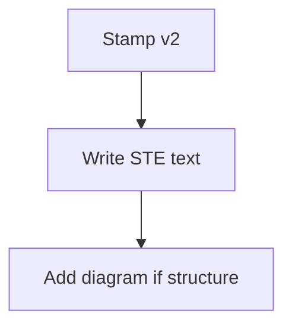

# Output Standard Concept Sample

> **TL;DR:** v2 pages use STE text and add a Mermaid diagram for structure.

## Overview

v2 pages use short active sentences.

Instructions stay at 20 words. Descriptions stay at 25 words.

## Structure

Add one Mermaid diagram when the page shows flow or hierarchy.

Keep a text summary beside the diagram.

**Least certain:**
- When a short list needs a diagram
- Which three edges are least certain
- Whether a table replaces the diagram

## Sources

^[raw/articles/output-standard-v2-concept.md]
