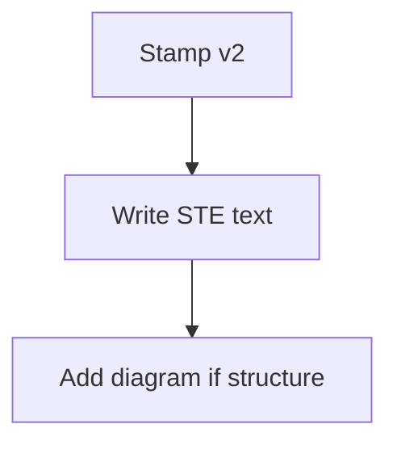

# Output Standard Concept Sample

> **TL;DR:** v2 pages use STE text and add a Mermaid diagram for structure.

## Overview

v2 pages use short active sentences.

Use at most 20 words for each instruction. Use at most 25 words for each description.

## Structure

Add one Mermaid diagram when the page shows flow or hierarchy.

Keep a text summary beside the diagram.

**Least certain:**
- `stamp --> write` edge: whether a later rewrite of a stub keeps the v2 stamp
- `Write STE text` label: how strictly agents apply the word caps in practice
- `write --> diagram` edge: when a short list still needs a diagram

## Sources

^[raw/articles/output-standard-v2-concept.md]
