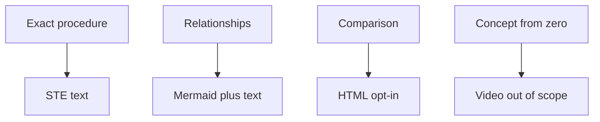

# Ingest output standard v2

> **TL;DR:** New ingest stubs stamp output_standard v2. Agents write Simplified Technical English (STE) text. CLI lint reports advisory warnings on marked pages only.

## Overview

Ingest output standard v2 is an authoring contract for typed SkillWiki pages.

`skillwiki ingest` stamps `output_standard: v2` on each new typed stub.

The CLI checks marked pages. It does not rewrite prose. It does not block publish.

## Rungs

Use STE text for an exact procedure that a reader will re-read later.

Add one Mermaid diagram when the page shows flow, components, timeline, hierarchy, or comparison.

Set `html_render: true` with `skillwiki ingest --html` or by hand.

Explainer video is out of scope. Use STE text plus a diagram.

**Least certain:**
- `comparison --> html` edge: this arrow is a mapping the source does not state as a required path
- `concept --> video` edge: this node is an interpretive grouping of the out-of-scope video rung
- `relations --> diagram` edge: this branch is a simplified split of table and diagram formats

## Format table

| Content type | Format | Rung | Policy |
| --- | --- | --- | --- |
| Exact procedure (re-read later) | STE text | 1 | default |
| Relationships (structure / flow / hierarchy) | Mermaid diagram + text | 2 | default |
| Comparison / hands-on exploration | HTML interactive page | 3 | opt-in; otherwise STE + table or diagram |
| Concept from zero | Explainer video | 4 | out of scope; use STE + diagram |

Formats stack. HTML is always opt-in. Video is outside the current scope.

## Uncertainty

The source reports no open uncertainty.

## Sources

^[raw/articles/ingest-output-standard-v2.md]
