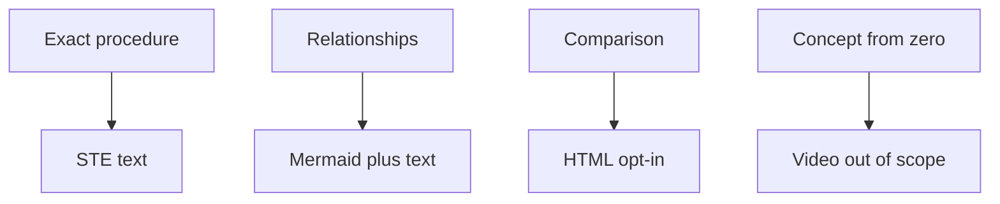

# Ingest output standard v2

> **TL;DR:** New ingest stubs stamp output_standard v2. Agents write STE-80 text. CLI lint WARNs marked pages only.

## Overview

Ingest output standard v2 is an authoring contract for typed SkillWiki pages.

`skillwiki ingest` stamps `output_standard: v2` on each new typed stub.

The CLI checks marked pages. It does not rewrite prose. It does not block publish.

## Rungs

Use STE text for an exact procedure that a reader will re-read later.

Add one Mermaid diagram when the page shows flow, components, timeline, hierarchy, or comparison.

Set `html_render: true` with `skillwiki ingest --html` or by hand.

Explainer video is out of scope. Use STE text plus a diagram.

**Least certain:**
- HTML opt-in for comparison pages
- Video remaining out of scope
- When formats should stack on one page

## Format table

| Content type | Format | Rung | Policy |
| --- | --- | --- | --- |
| Exact procedure (re-read later) | STE text | 1 | default |
| Relationships (structure / flow / hierarchy) | Mermaid diagram + text | 2 | default |
| Comparison / hands-on exploration | HTML interactive page | 3 | opt-in; otherwise STE + table or diagram |
| Concept from zero | Explainer video | 4 | out of scope; use STE + diagram |

Formats stack. HTML is always opt-in. Video is future.

## Uncertainty

A source hedge belongs in this section.

Example: the Karpathy post appears to treat video as a later format.

## Sources

^[raw/articles/ingest-output-standard-v2.md]
